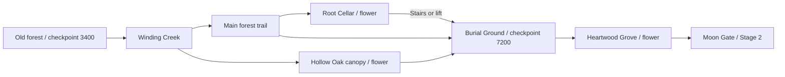

# Presentation and Stage 1 update

## Playing

- **F5** launches the title screen. Start Game begins a new journey; Continue appears only with a valid saved Stage 1 or Stage 2 checkpoint.
- Menu navigation: arrow keys, Tab, controller D-pad or left stick. Enter/Space/controller A selects; Escape/controller B closes Settings.
- Settings stores independent Music and SFX volumes in `user://audio_settings.cfg`. Defaults: Music 55%, SFX 85%, with additional per-track/per-effect gain.
- Two checkpoint lanterns at Stage 1 x=3400 and 7200 restore HP and save progress to `user://journey.cfg`. Try Again returns to the latest checkpoint in the current stage with full HP. Continue does the same after a restart.
- Start Game replaces checkpoint progress and resets collected flowers. Moon Gate still uses Up Arrow/E/Enter and carries Red's current HP to Stage 2. Stage 2 entry saves its starting checkpoint.
- Existing Space double jump, S+Space platform drop and L dash remain. Dash retains 0.7 seconds of invulnerability.

## Presentation and assets

The title uses the existing `forest_approach.png` castle/crimson-moon backdrop and Red's existing standing frame. Game Over reuses `deep_forest.png`, Red's final death frame, the existing watching wolf silhouette, procedural sword and fog/leaves. A small white flower, softer moonlight and slower petals give the scene a quiet hopeful accent. Both screens use nearest filtering for sprite art and a system serif font (`assets/menu_font.tres`) for readable UI.

No new character/environment images were generated or replaced for this update. The forest traps reuse the game's terrain drawing and color palette. Earlier supplied boss animation assets are preserved.

`GameSession` owns saves, checkpoints, menu controller mappings and scene fades. `AudioDirector` owns one persistent music player and a separate SFX pool. The old scene-local audio scripts now delegate to it. Old music fades out before the new track starts, preventing simultaneous music playback. Game Over music begins on lethal damage, while Red's existing down/death animations finish.

## Original music

These are **original synthesized compositions**, not Sonilo output or acoustic recordings. No reference-song melody, third-party samples or audio recordings were used. The compositions and synthesis code are in `tools/compose_story_music.py` (Python + NumPy).

| File | Arrangement | Length |
| --- | --- | --- |
| `audio/bgm/witchs_lullaby.wav` | E minor, 66 BPM, 3/4; music-box melody, delicate piano-like arpeggios and soft sustained pads | 65.45 s |
| `audio/bgm/promise_to_rise.wav` | A minor opening toward C major, 58 BPM, 4/4; distinct piano-like melody with warmer sustained harmony | 66.21 s |

Both are 44.1 kHz stereo PCM WAVs. Note tails and reverb wrap across the loop endpoint; runtime sets full-track sample loop points. New quiet hover/confirm chimes are also synthesized. Existing Stage 1 and Stage 2 scores remain in gameplay. A listening pass on the user's speakers/headphones is still needed for subjective tone and final volume preference. Higher fidelity Sonilo replacements can use the same paths/context profiles later.

## Stage 1 hazards

### Expanded exploration layout

Stage 1 is now **9600 px wide**, up from 4800. Camera bounds, save-position validation, decorative lanterns and map boundaries follow the new size. The Moon Gate is at x=9440, after the new Heartwood Grove. Old saves remain valid at their original coordinates; the old gate area at x=4660 now leads farther into the forest.

The original entrance/ruins paths lead into a winding creek, a tall hollow-oak canopy, an underground root cellar, a quiet burial-ground clearing and a final corrupted grove. The three creek routes reconnect:



Use **S+Space** on the marked root bridge between x=5800 and 7000 to enter the cellar. A vertical lift and stairs return to the main route, and wide lower shelves provide recovery after missed jumps. The canopy climbs to y=-28 and descends into the burial ground. Two optional cracked oak branches warn for 1.1 seconds before collapsing. Two vertical moving platforms serve the creek and cellar.

There are now six one-time healing flowers, tracked by a location/flower counter at the lower left of the HUD. The original two flowers retain their saved IDs. New flowers are at the oak crown (6540,-52), cellar alcove (6400,634), old grave (7840,332) and heartwood branch (8750,284). Two checkpoints replace the previous three, with no checkpoint at the gate. Initial wolf spawns stay at least 425 px from the lanterns and 160 px from marked trap pockets; chase behavior is unchanged.

Layout constants and reward/checkpoint positions: `scripts/stage1_definition.gd`. Routes and challenge placements: `scripts/stage1_layout.gd`. Decorative oak, creek and cellar: `scripts/stage1_exploration_scenery.gd`.

Reusable scenes live in `scenes/hazards/`. Width, damage, warning/rest/active timings and travel/collapse parameters are exported.

| Challenge | Position / route | Escape |
| --- | --- | --- |
| Small ground spikes | x=355, main floor | Jump, dash or introductory ledge |
| Retractable spikes | x=1115, main floor | 2.4 s safe rest, 0.8 s warning, 1 s active; wait or take ledges |
| Falling branch | x=1300 | 0.9 s shake and landing warning; move out of the marked zone |
| Thorn vines | x=2050 | Double jump or existing upper platforms |
| Cursed roots | x=2490 | 3 s rest, 0.9 s warning, 1.15 s pulse; wait, jump or dash |
| Wide ground spikes + moving ferry | x=3060 | 150 px ferry over the bed, or upper path |
| Optional crumbling route | x=3160/3330, above main path | 0.85 s warning; platforms return after 4 s; safe ground below |
| Late roots and branch | x=3920/4370 | Familiar warnings, clear landing areas and upper routes |

Each optional flower heals 12 HP once per journey. Flowers have stable landing shelves. Existing wolves can still pursue Red into trap areas.

The original lower catch floor remains at y=590 in the first half. A continuous catch floor at y=860 covers the larger map; the new cellar floor is at y=740. Return shelves rise in 55 px steps. Main floor collision is one-way from beneath, so it cannot trap Red below a solid ceiling. Moving/crumbling platforms support S+Space drop-through. Damage polygons use the same geometry as the drawn danger; retracting roots/spikes scale their collision with their visible height and disable it during safe rest/warnings.

## Verification

Run in Godot 4.7.2:

```powershell
& 'C:\Godot\Godot.exe' --headless --path . --script res://tools/tests/test_presentation.gd --log-file .godot/presentation_checks.log -- --presentation-test
python tools/tests/check_story_music.py
```

The Godot harness uses separate test save/settings filenames and deletes only those files on completion. It simulates actual UI input, Red's physics, hazard contacts and scene changes. It covers keyboard/controller menu events, Start/Continue, saved sound settings, death/retry/title, checkpoint HP, the Moon Gate/Stage 2 health carry, dash immunity, spike jumping, timed trap waiting, thorn double jumps, branch avoidance, ferry riding/drop-through, crumble warning/respawn and jumping up from the lower safety floor.

Before the map expansion, **58 checks passed, 0 failed** on Godot 4.7.2. The existing harness's checkpoint, gate and scene-count fixtures have been updated for the new layout, but it has not been rerun for this expansion. The two music files passed stereo/PCM, peak-headroom and loop-boundary sample continuity checks. Earlier results are in `.godot/presentation_visual_checks.log` and `.godot/presentation_checks/music_report.json`.

For screenshots, run the same script with the Windows display driver (omit `--headless`). Captures and logs go to ignored `.godot/presentation_checks/`; title, Settings, Game Over and the Root Passage have been visually inspected at 960×540.

Remaining review: run the existing harness against the expanded stage and play through the new canopy/cellar routes; also review actual controller hardware and subjective music quality/balance. Existing duplicate UIDs in the archived `assets/spin_attack_previous/` imports and the Camera2D physics-interpolation notice predate this update.
