# Stage 1 environment v2 integration

Implemented 2026-10-14 using `stage1_environment_assets_v2_for_codex.zip` after the user selected v2. All 37 original PNGs are copied unchanged to `assets/environment/stage1_v2/`. Their SHA-256 hashes match the reviewed ZIP files.

Presentation update, 26 October 2026: the bridge now frames the existing flat crossing with two supports and a subtle rope, without overlapping curved deck images. Scaled terrain/scenery use linear filtering, and the two upper ledges retain the finished terrain kit. See [bridge presentation notes](bridge_presentation_cleanup.md). Original validation results and older gallery images below describe the initial integration.

## Placement

| Area | Result |
|---|---|
| Broken Chapel | A back wall and main arch frame the existing Moon Shrine, with slender side pillars, attached banner, fallen bell and small rubble clusters. |
| Hollow Oak | A complete large Oak and hollow replace the drawn trunk skeleton, with supporting branch/root pieces and a root-framed cellar entrance. |
| Root Cellar | Hanging ceiling roots, corner/ground roots and the existing dark backing distinguish the lower route without adding collision. |
| Lift | Separate moving deck, fixed top beam and side frames, with overlapping chain sections that adjust to the deck height. |
| Bridge | Two restrained supports and a back rope frame the existing flat crossing. The overlapping curved bridge/segment images are no longer displayed. |
| Burial ruins | Uneven clusters of graves, cross, fence and rubble, with a collapsed-crypt arch and a small viewpoint grave. |
| Camp | Tent, supplies, stool, static fire and lanterns form a small camp. Restrained warm lights complement the existing forest lighting. |
| Upper ruins | Wall/arch/column silhouettes frame the ascent and sanctuary. Walkable ledges use the finished terrain kit rather than coarse v2 surface replacements. |
| Heartwood | A subdued branch silhouette and roots replace the old drawn tree lines, preserving open combat space. |

Decorations render behind Red, enemies and interactions. Environment sprites and the shared terrain kit use linear texture filtering and uniform scale; the separate lift rig retains its existing filtering. No sprite silhouette generates collision. The old duplicate line/rectangle landmarks, scattered grey graves and stick-drawn lantern posts are suppressed in this mode; water reflections, darkness backing, tutorial text, hazard warnings and story cues remain engine drawings.

## Lift and source-art handling

The 220-pixel collider, six-second period and 240-pixel vertical travel remain unchanged. The fixed beam sits 58 pixels above the upper stop, so chains retain visible length at both stops. The fixed mechanism is a sibling of the moving body. Only the deck is parented to the lift.

Chain texture regions exclude transparent end padding, overlap by two world pixels and clip the last segment in Godot to meet the deck. Camp crate/stool regions exclude their bottom export strips at source y=230. These are scene-side presentation settings; every supplied PNG stays intact.

The v2 pillar/banner proportions and some softer details remain characteristics of the supplied artwork. They are used at restrained sizes, with no additional independent X/Y stretching. Replacement source exports can be swapped later if desired.

## Controls and recovery

- `Stage1Layout.environment_art_enabled`: enables this dressing pass and the new lift visuals. Restart the scene after changing this flag. Disabling it restores the legacy drawn scenery and lift artwork.
- `Stage1EnvironmentArt.brightness`: matches the existing forest `scenery_brightness` control, default 0.82. The forest lighting system forwards changes to the scenery sprites.
- `CellarLiftArt.beam_clearance`: visual clearance above the upper stop, default 58. Changing it before the rig builds adjusts fixed mechanism placement.

Backup of scripts, scenes and project settings before integration:
`.godot/local_backups/stage1-environment-v2-20261014-171228/`.

## Original integration validation (14 October 2026)

- Actual-renderer environment review: 260 checks passed, including equality of 438 collision/body configuration entries between v2 and the legacy mode, all 37 source assets represented, no decorative colliders, uniform scales, nearest filtering, fixed mechanism placement, gap-free chain overlap and deck endpoint alignment at lower/middle/upper stops.
- Moon Seal flow: 335 checks passed, including order, guarding, activation, Wisp release and reload behavior.
- Moon Lantern/checkpoint interaction: 69 checks passed, including E activation, cancellation, retry and restoration.
- Stage 1 routes: 93 checks passed with v2 enabled and disabled. Covered normal movement/jumping, required seal routes, optional branches, all six optional Moon Petals, cellar return stairs and actual lift riding.
- The v2 route test also passed all 93 checks using the real OpenGL renderer, with no script or shader errors.
- Original PNG hash comparison: zero mismatches.

Route test timing was updated to wait for animated seal activation and the delayed Wisp camera tour before continuing. It also accepts a safe interior landing if the automated helper cannot center Red exactly on a broad shelf. The player and combat controller were not changed to accommodate the test.

Logs are `.godot/stage1_environment_v2_capture.log`, `.godot/environment_routes_v2_rendered.log`, `.godot/environment_routes_v2.log`, `.godot/environment_routes_legacy.log`, `.godot/env_v2_test_moon_seal_flow.log` and `.godot/env_v2_test_moon_lantern.log`.

These are controlled automated tests. Enemies are frozen or cleared for visual/traversal captures; the dedicated seal test verifies guard restrictions. This is not a full manual combat playthrough. Normal journey saves are preserved through separate test save paths.

Headless route runs omit decorative petals because their sampler shader needs the actual renderer. The separate rendered route run includes the full scenery and petals.

## Gameplay-scale preview gallery

Each area has a matching `_before.png` in the same directory. Lift review images use a fixed camera at gameplay zoom to show the entire shaft.

### Broken Chapel

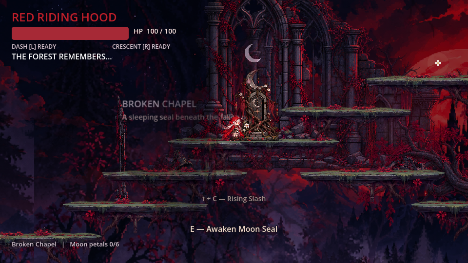

### Lift, lower stop

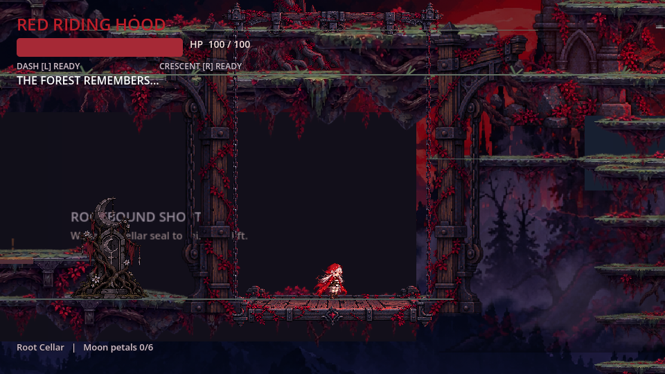

### Hollow Oak

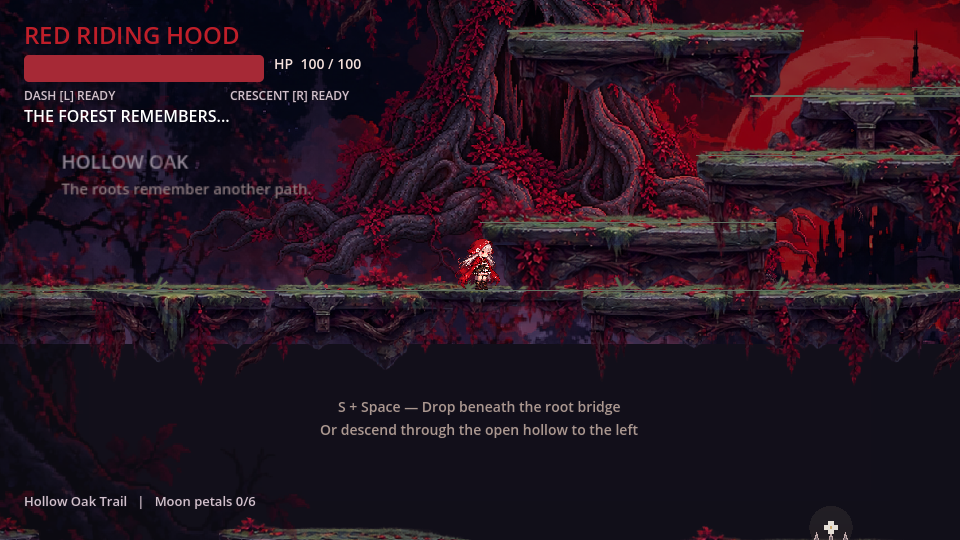

### Cellar entrance

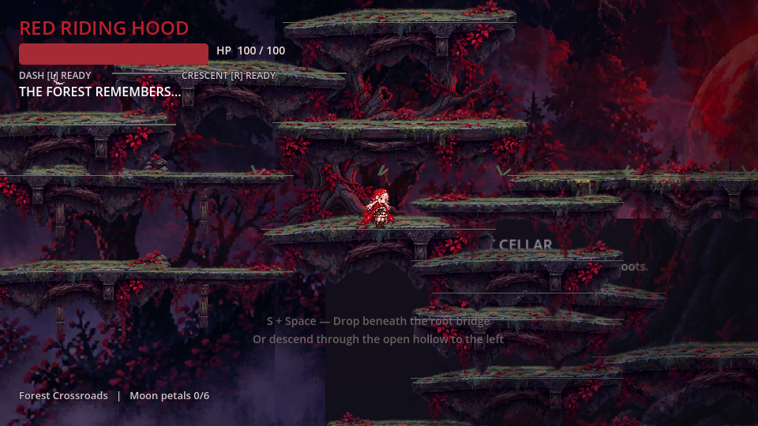

### Root Cellar

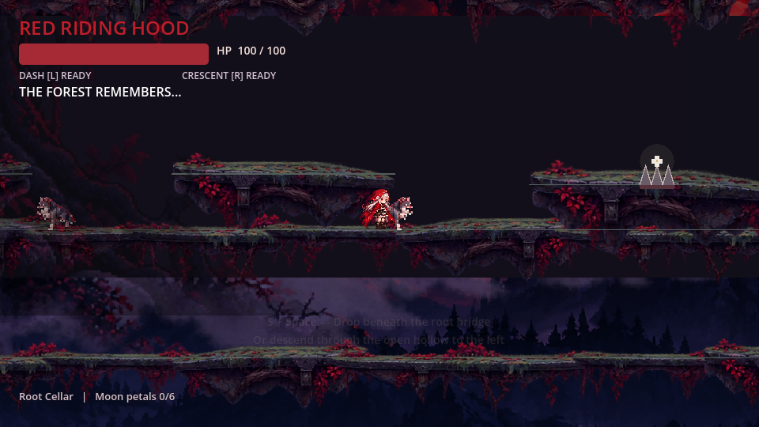

### Camp

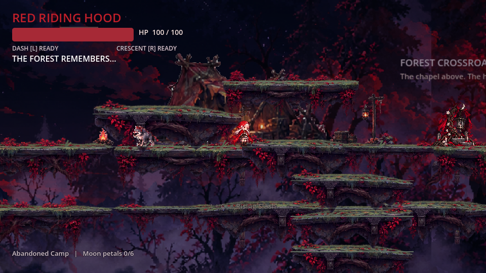

### Ruined Bridge

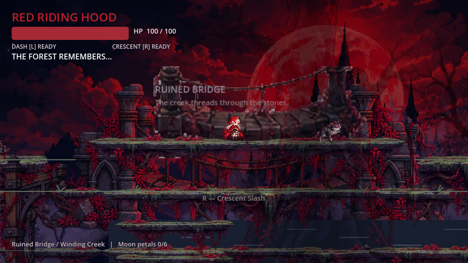

### Burial ruins

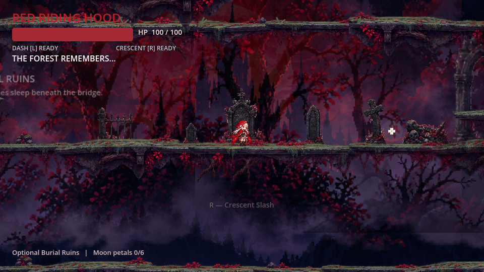

### Upper route

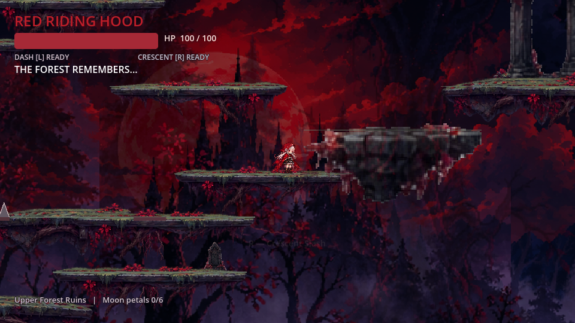

### Upper Sanctuary

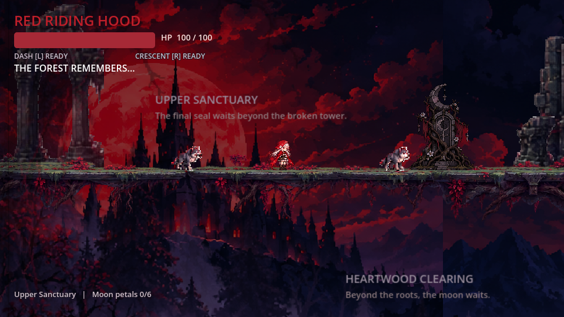

### Heartwood

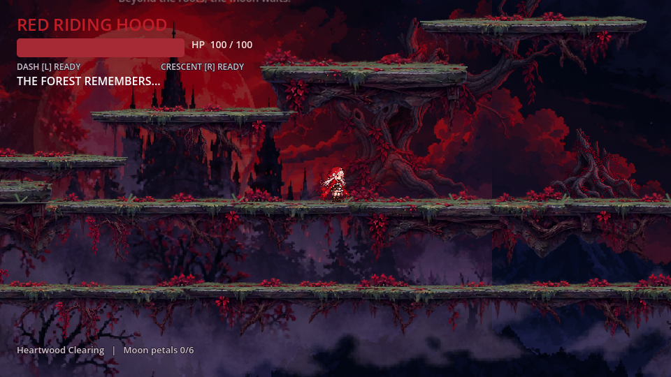
